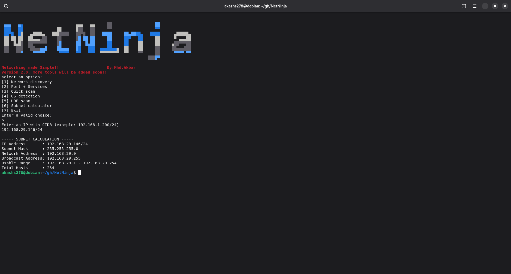

<center>

</center>


# NetNinja 🔍

NetNinja is a comprehensive network reconnaissance tool that combines multiple networking utilities into a single, user-friendly interface. Built primarily with Bash, it leverages powerful tools like Nmap to provide essential network scanning capabilities.


##  Features
- **Network Discovery**: Find live hosts on a network
- **Port Scanning**: Identify open ports and services  
- **Service Detection**: Determine service versions and configurations
- **Quick Scanning**: Fast network assessment options
- **User-Friendly CLI**: Color-coded, intuitive interface
- **A subnet calculator**:everything!for networking.


### Prerequisites
Ensure you have the following installed:
- **Git** (for cloning repository)
- **Nmap** (Network Mapper)

**Note :** Make sure you have installed the git. Other prerequisites are installed automatically no need to worry about it. 


## 📦 Installation
```bash
git clone https://github.com/Akbar1109/NetNinja.git
cd NetNinja
chmod +x netninja.sh
./netninja.sh
```


 ### Acknowledgments

 Nmap Security Scanner (https://nmap.org)

Open source community

Security researchers and educators

 ### More tools will be added in upcoming updates 
 ### NetNinja V2.0
 ### Author:Akbar.
 =========================================================